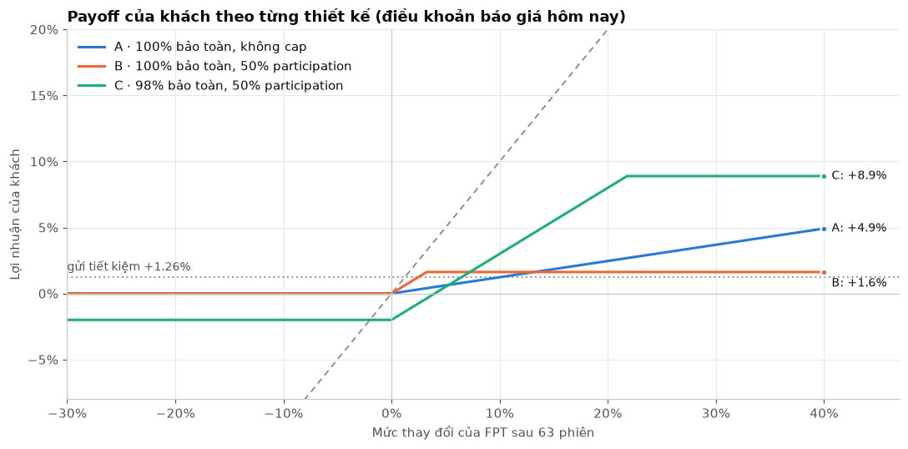
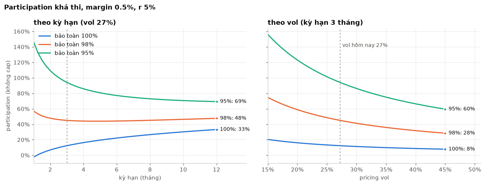
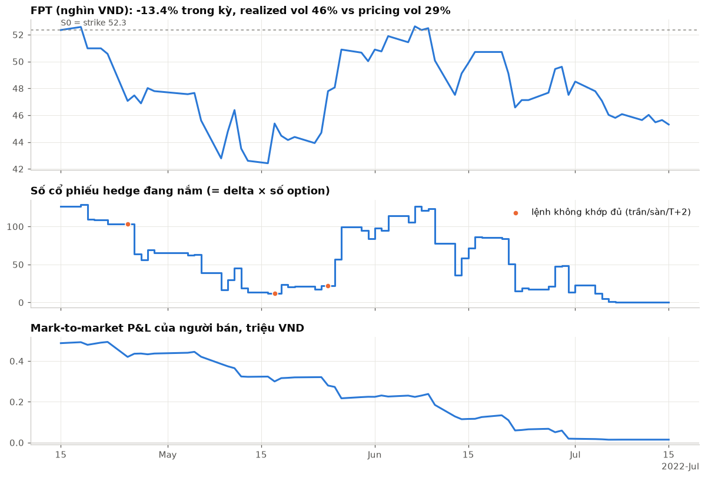
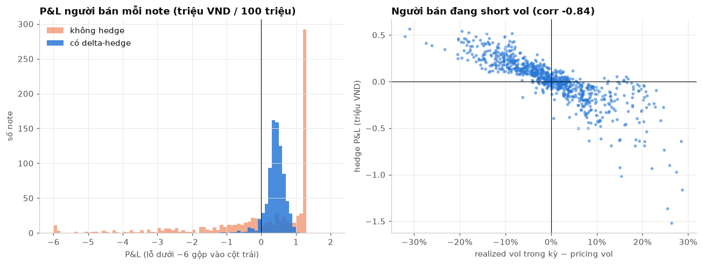
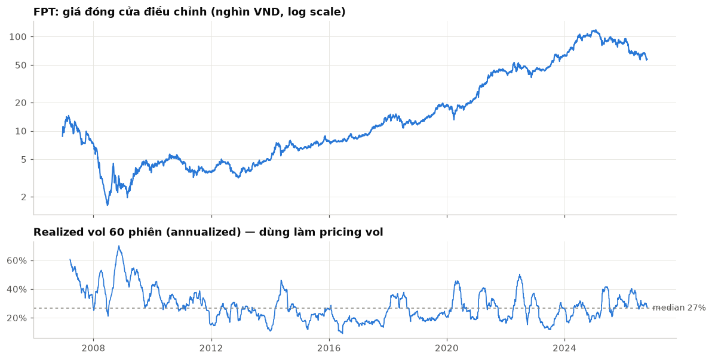
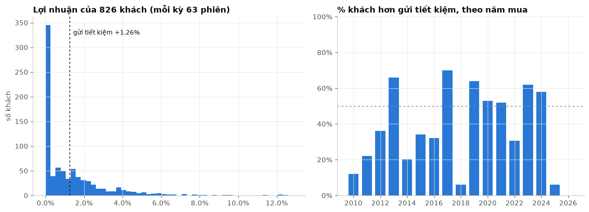
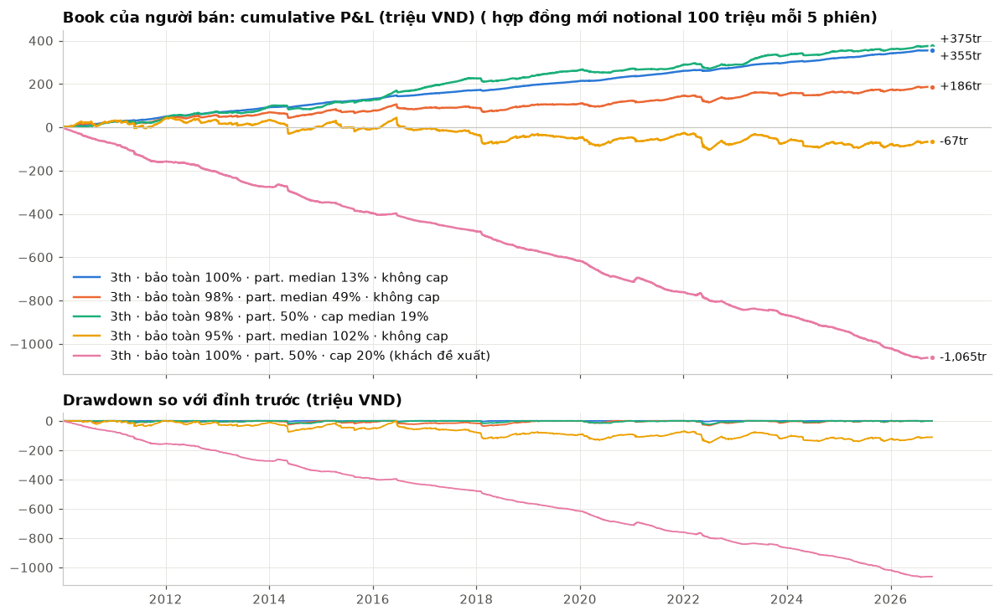
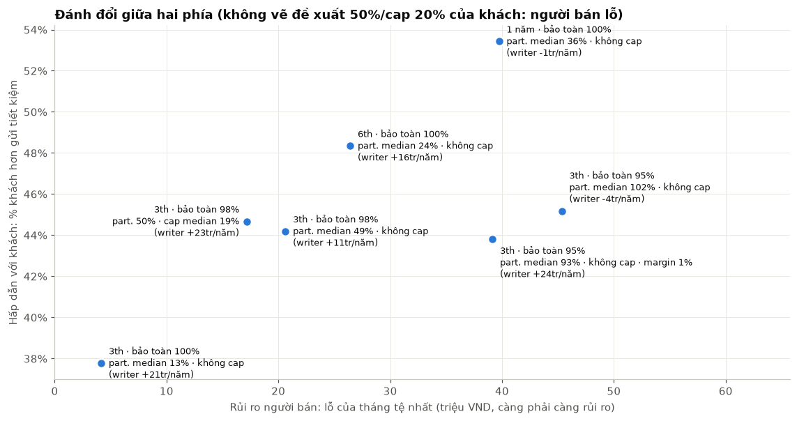
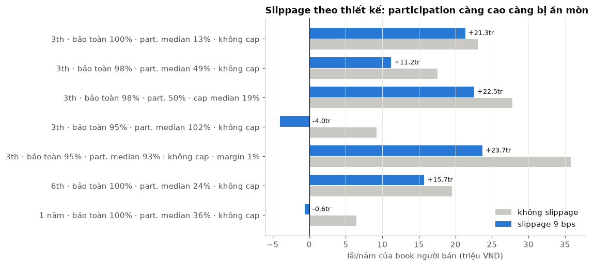
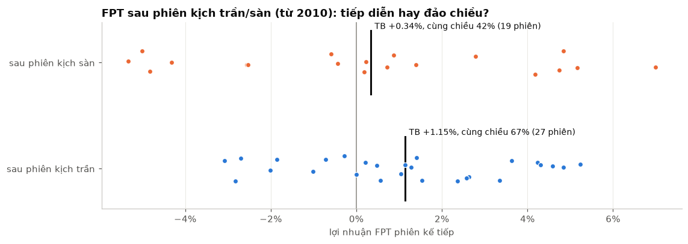

# Note bảo toàn vốn trên cổ phiếu FPT

*Báo cáo nghiên cứu, bản nháp để góp ý. Dữ liệu FPT tới phiên 22/10/2026. Mọi số liệu lấy từ output đã lưu của `note_research.ipynb`, trừ một số số liệu bổ sung (note 03/03/2025, số phiên kịch trần/sàn, số note sống trung bình và notional outstanding, mức tiết kiệm phí của netting, participation cao/thấp nhất, edge của đề xuất khách, giá call bình quân 5 phiên) được tính từ `note_backtest.py`, `notes_FPT.csv`, `book_FPT.csv` với cùng tham số mặc định. Đơn vị: tr = triệu VND, trên một note 100tr.*

---

## Tóm tắt

**Câu hỏi.** Người bán (người phát hành) nhận của khách 100tr. Sau kỳ hạn (mặc định 3 tháng = 63 phiên) khách nhận lại ít nhất một mức bảo toàn của gốc, cộng thêm một phần mức tăng của FPT. Khách không bán lại được hợp đồng. Ba câu hỏi: (1) với lãi suất và vol của FPT, điều khoản nào khả thi; (2) nếu bán đều đặn cho nhiều khách từ 2010 và delta-hedge hằng ngày thì người bán lãi/lỗ ra sao; (3) khách được gì so với gửi tiết kiệm và so với tự mua FPT.

**Phương pháp.** Mỗi note được tách thành một bond leg (để trả gốc) và một call hoặc call spread trên FPT, định giá bằng Black–Scholes với pricing vol là realized vol 60 phiên gần nhất. Backtest bán một note mới mỗi 5 phiên từ 2010 (826 note cho kỳ hạn 3 tháng), delta-hedge mỗi phiên tại giá đóng cửa, có tính phí, slippage, kịch trần/sàn và T+2.

**Các số chính** (kỳ hạn 3 tháng trừ khi ghi khác, margin 0,5%, r 5%; chi tiết ở mục 6):

| thiết kế | participation (median) | khách: lợi nhuận TB/kỳ | khách: % hơn gửi tiết kiệm | người bán: lãi/năm | người bán: tháng tệ nhất |
|---|---|---|---|---|---|
| bảo toàn 100%, không cap | 13,4% | +1,3% | 37,8% | +21,3tr | −4,2tr |
| bảo toàn 98%, không cap | 48,9% | +2,7% | 44,2% | +11,2tr | −20,6tr |
| bảo toàn 98%, 50% participation, cap median 19,3% | 50,0% | +2,0% | 44,7% | +22,5tr | −17,2tr |
| bảo toàn 95%, không cap | 102,2% | +4,9% | 45,2% | −4,0tr | −45,3tr |
| khách đề xuất: bảo toàn 100%, 50%, cap 20% | 50,0% | +3,6% | 57,7% | −64,0tr | −24,2tr |

"Lãi/năm" là lãi của cả book người bán (trung bình khoảng 12–13 note đang sống, khoảng 1,24 tỷ notional outstanding), sau phí và slippage.

**Rủi ro chính.**

- Người bán đang **short vol**: hedge P&L có tương quan −0,84 với (realized vol − pricing vol). Lỗ tập trung ở các cú tăng giá đột ngột sau giai đoạn yên ắng.
- Mức participation càng cao thì option càng lớn so với margin: drawdown, tháng tệ nhất và chi phí giao dịch tăng theo.
- Không có thị trường option niêm yết trên FPT, nên không có implied vol; pricing vol lấy từ quá khứ nên chậm khi vol đổi chế độ.
- Cách thanh toán (total return hay price return, một giá đóng cửa hay bình quân 5 phiên) và thời điểm chốt S0 chưa được quy định; đây là các điểm cần viết vào hợp đồng (mục 8).

---

## Thuật ngữ và ký hiệu

### Thuật ngữ

| thuật ngữ | ý nghĩa |
|---|---|
| option | Hợp đồng cho người mua một **quyền** (không phải nghĩa vụ) mua hoặc bán một tài sản ở một giá định trước, vào một ngày định trước. Người mua trả tiền để có quyền đó. |
| call | Option cho quyền **mua**. Có giá trị khi giá cổ phiếu lúc đáo hạn cao hơn strike: người cầm call hưởng phần tăng, không chịu phần giảm. |
| put | Option cho quyền **bán**. Có giá trị khi giá cổ phiếu giảm dưới strike. Báo cáo này không dùng put. |
| strike | Giá định trước trong option. Ở đây strike = giá FPT lúc bán note (S0), tức call "at the money" (ATM). |
| payoff | Số tiền một hợp đồng trả ra khi đáo hạn, tính theo giá lúc đó. Payoff của call: max(S_T − K, 0). |
| premium | Giá phải trả để mua option. Người bán option nhận premium và gánh nghĩa vụ trả payoff. |
| notional | Số tiền danh nghĩa của hợp đồng, ở đây là số tiền khách đóng: 100tr. |
| protection | Mức bảo toàn: phần trăm notional chắc chắn trả lại cho khách khi đáo hạn (100% = nhận lại đủ gốc, 98% = nhận lại ít nhất 98tr). |
| participation | Tỉ lệ khách được hưởng trên mức tăng của FPT. Participation 50% và FPT tăng 10% thì khách được thêm 5% notional. |
| cap | Mức tăng tối đa của FPT được tính cho khách. Cap 20%: FPT tăng 30% thì vẫn chỉ tính 20%. |
| margin | Phần người bán giữ lại cho mình trên mỗi note, chốt ngay lúc bán (mặc định 0,5% notional = 0,5tr). |
| budget (option budget) | Số tiền còn lại để mua phần tăng cho khách, sau khi đã để riêng tiền trả gốc và margin. |
| bond leg | Phần tiền người bán để riêng (gửi/đầu tư ở lãi suất r) sao cho tới đáo hạn lớn lên đúng bằng số tiền bảo toàn. |
| call spread | Mua một call strike thấp và bán một call strike cao hơn. Hưởng phần tăng giữa hai strike, không hưởng phần vượt strike cao. Đây là cách tạo ra cap. |
| vanilla option | Option chuẩn, đơn giản (một call hoặc một put), mua bán riêng với premium trả trước. |
| structured product / note | Sản phẩm đóng gói từ nhiều phần: ở đây một bond leg cộng một call hoặc call spread. Khách không trả premium riêng; điều khoản (participation, cap) được tính ra từ số tiền khách đóng. |
| delta | Mức thay đổi giá option khi giá cổ phiếu thay đổi 1 đồng; với call nằm giữa 0 và 1. Delta 0,5 nghĩa là option đang "giống" nửa cổ phiếu. |
| gamma | Tốc độ thay đổi của delta khi giá cổ phiếu đổi. Lớn nhất khi giá gần strike và gần đáo hạn. |
| vega | Mức thay đổi giá option khi vol thay đổi. Vol cao thì option đắt hơn. |
| delta-hedge | Người bán option nắm giữ số cổ phiếu bằng delta × số option, điều chỉnh mỗi phiên, để lãi/lỗ trên cổ phiếu bù lãi/lỗ trên option. |
| hedge P&L | Lãi/lỗ của cả gói "option đã bán + cổ phiếu hedge", sau khi option đáo hạn. Dương khi giá thực tế dao động ít hơn mức đã định giá. |
| mark-to-market | Định giá lại vị thế mỗi ngày theo giá hiện tại để thấy lãi/lỗ chưa thực hiện. |
| P&L | Lãi/lỗ. |
| realized vol | Mức dao động thực tế của giá, đo bằng độ lệch chuẩn của log return hằng ngày, quy năm (× √252). |
| pricing vol | Vol người bán dùng để định giá option lúc bán note. Ở đây = realized vol 60 phiên gần nhất. |
| implied vol | Vol suy ngược từ giá option trên thị trường. FPT không có thị trường option niêm yết nên không có implied vol. |
| short vol | Vị thế có lãi khi vol thực tế thấp và lỗ khi vol thực tế cao. Người bán option đã delta-hedge đang short vol. |
| slippage | Chi phí do khớp lệnh ở giá kém hơn giá giữa: mua ở giá chào bán, bán ở giá chào mua. Ở đây tính bằng nửa bid-ask spread. |
| turnover | Tổng giá trị cổ phiếu mua và bán để hedge trong đời một note. |
| book | Toàn bộ các note đang sống của người bán, gộp lại như một danh mục. |
| notional outstanding | Tổng notional của các note còn đang sống tại một thời điểm. |
| drawdown / max drawdown | Mức sụt của lãi lũy kế so với đỉnh trước đó; max drawdown là mức sụt lớn nhất trong cả giai đoạn. |
| rolling (note chồng lấn) | Bán note mới đều đặn (mỗi 5 phiên) trong khi các note cũ chưa đáo hạn, nên nhiều note sống cùng lúc và đời của chúng chồng lên nhau. |
| Black–Scholes | Công thức định giá option chuẩn, giả định vol không đổi và hedge liên tục. Đầu vào: giá cổ phiếu, strike, kỳ hạn, lãi suất, cổ tức, vol. Công thức ở Phụ lục A. |
| total return vs price return | Total return tính cả cổ tức (giá đã điều chỉnh cổ tức); price return chỉ tính thay đổi giá giao dịch. |
| kịch trần / kịch sàn | Phiên đóng cửa ở giá trần (tăng tối đa biên độ) hoặc giá sàn (giảm tối đa) của HOSE. Khi kịch trần gần như không mua được, kịch sàn gần như không bán được. |
| T+2 | Cổ phiếu mua ở phiên T chỉ về tài khoản và bán được từ phiên T+2. |
| median | Giá trị ở giữa khi xếp từ nhỏ tới lớn: một nửa số quan sát nhỏ hơn, một nửa lớn hơn. Ít bị kéo bởi vài giá trị cực đoan hơn so với trung bình. |

### Biến dùng chung

| ký hiệu | ý nghĩa | đơn vị / ví dụ |
|---|---|---|
| N | notional của một note | 100tr |
| S | giá FPT (giá đóng cửa điều chỉnh) | VND; 57.400 ngày 22/10/2026 |
| S0 | giá FPT lúc bán note, cũng là strike | 52.343,73 cho note 15/04/2022 |
| S_T | giá FPT lúc đáo hạn | VND |
| K | strike | = S0 (call ATM); strike thứ hai của call spread = S0·(1 + cap) |
| R | mức thay đổi của FPT trong kỳ, R = S_T/S0 − 1 | −13,4% cho note 15/04/2022 |
| T | kỳ hạn tính theo năm, T = n/252 | 63/252 = 0,25 |
| n | số phiên của kỳ hạn | 63 (≈ 3 tháng); 126; 252 |
| Δt | độ dài một phiên tính theo năm | 1/252 |
| r | lãi suất (liên tục, theo năm), dùng cho bond leg, tiền mặt và định giá | 5% |
| q | tỉ suất cổ tức | 0 (giá đã điều chỉnh cổ tức, xem mục 8) |
| σ | vol (quy năm) | 27,2% ngày 22/10/2026 |
| σ_pricing | pricing vol lúc bán note | realized vol 60 phiên tới ngày bán |
| σ_realized | realized vol thực tế trong đời note | đo sau khi note đáo hạn |
| V / V0 | giá trị phần option đã bán cho khách / lúc bán | V0 = 0,742tr cho note 100% bảo toàn |
| C | giá call ATM, tính theo % notional | khoảng 6,0% (≈ 6,0tr) với kỳ hạn 3 tháng, vol 27% |
| Δ | delta | 0,563 ngày đầu của note 15/04/2022 |
| Γ | gamma | |
| protection | mức bảo toàn | 100%, 98%, 95% |
| p | participation | 12,3% (báo giá hôm nay, bảo toàn 100%) |
| cap | mức tăng tối đa được tính | 20%; "không cap" |
| margin | phần người bán giữ, % notional | 0,5% = 0,5tr lúc bán, lớn lên thành 0,506tr lúc đáo hạn |
| budget | N − N·protection·e^(−rT) − margin | 0,74tr (3 tháng, bảo toàn 100%) |
| bond leg | N·protection·e^(−rT) | 98,76tr (3 tháng, bảo toàn 100%) |
| edge | N − bond leg − V0: margin thực tế của người bán khi điều khoản cho trước | âm nếu điều khoản quá hào phóng |
| h_k | số cổ phiếu hedge nắm giữ sau phiên k (= Δ × số option) | 126,2 cổ phiếu (điều chỉnh) ngày đầu note 15/04/2022 |

---

## 1. Sản phẩm là gì

Khách đóng 100tr hôm nay. Sau 3 tháng khách nhận:

- **phần bảo toàn**: chắc chắn nhận lại protection × 100tr (ví dụ 100tr hoặc 98tr), dù FPT giảm bao nhiêu;
- **phần thưởng**: nếu FPT tăng, nhận thêm participation × mức tăng của FPT, tính tối đa tới cap.

Nếu FPT giảm hoặc đứng yên, khách chỉ nhận lại phần bảo toàn. Khách không bán lại được hợp đồng giữa kỳ.

> **Payoff khi đáo hạn**
> `Khách nhận = N × [protection + participation × min(max(R, 0), cap)]`, với `R = S_T/S0 − 1`.
> Không có cap thì bỏ `min(·, cap)`.

### Ba thiết kế báo giá ngày 22/10/2026

Báo giá dùng FPT 57.400 VND, vol 27,2%, r 5%, margin 0,5%, kỳ hạn 63 phiên. Mỗi thiết kế cho trước hai tham số, tham số còn lại được giải ra:

| thiết kế | protection | participation | cap (trên mức tăng FPT) | lợi nhuận tối đa của khách |
|---|---|---|---|---|
| A · 100% bảo toàn, không cap | 100% | 12,3% | không | không giới hạn |
| B · 100% bảo toàn, 50% participation | 100% | 50,0% | 3,2% | +1,62% |
| C · 98% bảo toàn, 50% participation | 98% | 50,0% | 21,8% | +8,89% |

### Kịch bản trên một note 100tr

Số tiền khách nhận sau 63 phiên (tr), so với gửi tiết kiệm cùng kỳ hạn (+1,26%) và tự mua FPT (theo giá điều chỉnh, tức đã gồm cổ tức):

| FPT sau 3 tháng | A (100%, 12,3%) | B (100%, 50%, cap 3,2%) | C (98%, 50%, cap 21,8%) | gửi tiết kiệm | tự mua FPT |
|---|---|---|---|---|---|
| −10% | 100,00 | 100,00 | 98,00 | 101,26 | 90,00 |
| 0% | 100,00 | 100,00 | 98,00 | 101,26 | 100,00 |
| +10% | 101,23 | 101,62 | 103,00 | 101,26 | 110,00 |
| +20% | 102,46 | 101,62 | 108,00 | 101,26 | 120,00 |
| +30% | 103,69 | 101,62 | 108,89 | 101,26 | 130,00 |

Cách đọc:

- **A** không bao giờ lỗ gốc, nhưng FPT phải tăng hơn khoảng 10,3% trong 3 tháng thì A mới hơn gửi tiết kiệm (12,3% × 10,3% ≈ 1,26%).
- **B** cũng không lỗ gốc; FPT chỉ cần tăng hơn khoảng 2,5% là B hơn gửi tiết kiệm, nhưng khách không bao giờ nhận quá +1,62%, tức chỉ hơn gửi tiết kiệm tối đa khoảng 0,36 điểm %.
- **C** có thể mất tối đa 2tr gốc, đổi lại FPT tăng hơn khoảng 6,5% thì C hơn gửi tiết kiệm, và khách có thể nhận tới +8,89%.
- So với tự mua FPT: cả ba thiết kế đều kém hơn khi FPT tăng mạnh và tốt hơn khi FPT giảm. Sản phẩm đổi phần lớn mức tăng lấy sự an toàn của gốc.


*Payoff của khách theo mức thay đổi FPT: so ba đường màu với đường chấm ngang (gửi tiết kiệm) và đường gạch chéo (tự mua FPT).*

---

## 2. Người bán tạo ra sản phẩm thế nào

### Chia 100tr của khách làm ba phần

Với kỳ hạn 3 tháng, bảo toàn 100%, r 5%:

```
Khách đóng 100,00tr
├── 98,76tr  bond leg: để riêng ở lãi suất r; sau 3 tháng lớn lên đúng 100tr để trả gốc
├──  0,74tr  budget: tiền dùng để "mua" phần tăng của FPT cho khách
└──  0,50tr  margin: phần người bán giữ lại (lớn lên thành 0,506tr khi đáo hạn)
```

Toàn bộ "nguyên liệu" để trả phần thưởng cho khách là tiền lãi 3 tháng của 100tr, khoảng 1,24tr; người bán lấy 0,50tr làm margin, còn 0,74tr là budget.

### Call option: quyền hưởng phần tăng, có giá

Phần thưởng của khách ("nếu FPT tăng thì được thêm, nếu giảm thì không mất gì") chính là payoff của một **call** với strike = S0. Call có giá: một call ATM 3 tháng trên 100tr giá trị FPT, ở vol 27%, có giá khoảng 6,0tr theo Black–Scholes. Lý do call đắt hơn tiền lãi: người cầm call hưởng toàn bộ phần tăng nhưng không chịu phần giảm, và FPT có thể tăng nhiều trong 3 tháng.

### Participation = budget mua được bao nhiêu phần của một call ATM

Budget 0,74tr chỉ mua được khoảng 0,74/6,0 ≈ 12,3% của một call ATM trên 100tr. Đó chính là participation của thiết kế A: khách được hưởng 12,3% mức tăng của FPT.

> `participation = budget / C`, với C = giá call ATM tính trên N.

### Cap = bán lại phần tăng vượt cap

Muốn participation cao hơn mà không tăng budget, khách có thể **bỏ phần tăng vượt cap**. Về mặt option, người bán vẫn bán cho khách call strike S0, nhưng đồng thời "mua lại" từ khách call strike S0·(1 + cap). Giá của call strike cao này được trừ vào chi phí, nên cùng một budget mua được nhiều phần hơn. Nhìn từ phía khách, gói "mua call S0, bán call S0·(1+cap)" là một **call spread**; người bán giữ vị thế ngược lại.

- Thiết kế B: muốn 50% participation với budget 0,74tr thì cap phải rất thấp, 3,2%.
- Thiết kế C: hạ bảo toàn xuống 98% làm budget tăng lên khoảng 0,74 + 1,98 = 2,72tr; budget đó mua được 50% participation với cap 21,8%.

### Vì sao đây là structured note, không phải vanilla option

| | vanilla call | note bảo toàn vốn |
|---|---|---|
| khách trả gì | premium (khoảng 6,0tr cho call ATM trên 100tr) | 100tr notional |
| khách có thể mất | toàn bộ premium | 0 (bảo toàn 100%) hoặc phần chênh (98%: tối đa 2tr) |
| khách nhận gì | max(S_T − K, 0) trên số cổ phiếu tương ứng | protection × N + participation × phần tăng (có thể có cap) |
| điều khoản được báo | giá option | participation hoặc cap, giải ra từ budget |
| bán lại giữa kỳ | tùy thị trường | không |

Với người bán, note = **bond leg + short call (hoặc call spread)**. Bond leg trả gốc; phần option là rủi ro thật sự, và người bán phải quản lý nó bằng delta-hedge (mục 4).

---

## 3. Điều khoản phụ thuộc vào gì

### Budget so với giá call

Participation là tỉ số giữa hai đại lượng:

> `participation (không cap) = [1 − protection·e^(−rT) − margin] / C`, với mọi đại lượng tính theo % notional (C = giá call ATM của một cổ phiếu chia cho S0).

Tử số là budget, mẫu số là giá call ATM. Mọi yếu tố đều đi qua một trong hai:

| yếu tố | tác động lên budget | tác động lên giá call | kết quả với participation |
|---|---|---|---|
| r cao hơn | bond leg rẻ hơn, budget tăng | call đắt hơn một chút | tăng |
| kỳ hạn dài hơn | tiền lãi nhiều hơn, budget tăng gần tỉ lệ với T | call đắt hơn nhưng chỉ theo √T | tăng (với bảo toàn 100%) |
| vol cao hơn | không đổi | call đắt hơn | giảm |
| protection thấp hơn | budget tăng mạnh | không đổi | tăng mạnh |
| margin cao hơn | budget giảm | không đổi | giảm |

Kỳ hạn 1 tháng với bảo toàn 100% cho participation **âm**: tiền lãi 1 tháng (khoảng 0,4%) không đủ trả margin 0,5%.


*Participation khả thi theo kỳ hạn (trái) và theo vol (phải): đường 100% tăng theo kỳ hạn, cả ba đường giảm khi vol tăng.*

Đọc từ biểu đồ (vol 27%, margin 0,5%, r 5%): ở kỳ hạn 12 tháng participation là 33% (bảo toàn 100%), 48% (98%), 69% (95%). Ở kỳ hạn 3 tháng, khi vol đi từ 15% lên 45%, participation của bảo toàn 100% giảm từ khoảng 20% xuống 8%.

### Một điểm bảo toàn đắt bao nhiêu

Ở kỳ hạn 3 tháng, mỗi 1% bảo toàn tốn 1tr × e^(−rT) ≈ 0,99tr trên note 100tr. Với call ATM khoảng 6,0tr, 0,99tr mua được khoảng 16 điểm participation; khi vol thấp hơn (call rẻ hơn) thì được khoảng 20 điểm.

> **Quy tắc nhớ nhanh (3 tháng):** 1% bảo toàn ≈ 1tr/note ≈ 16–20 điểm participation.

Vì vậy bảo toàn 100% → 98% đưa participation (median lịch sử) từ 13,4% lên 48,9%, và 95% lên 102,2%.

### Ví dụ: đề xuất của khách

Khách đề xuất: **bảo toàn 100%, participation 50%, cap 20%**.

- Ở bảo toàn 100%, budget chỉ có 0,74tr.
- 50% participation với cap khoảng 20% cần budget cỡ thiết kế C (bảo toàn 98%), tức khoảng 2,72tr; báo giá hôm nay của C cho cap 21,8%.
- Phần thiếu chính là giá của 2% bảo toàn thêm: khoảng 1,98tr hôm nay, gần gấp 3 lần toàn bộ budget 0,74tr của thiết kế 100%.
- Vì điều khoản đã cố định, edge (margin thực tế) trở thành số dư âm: khoảng **−1,3tr/note** (median qua các ngày bán lịch sử; theo báo giá hôm nay khoảng −1,4tr).

Backtest cho cùng kết quả: book của đề xuất này lỗ −64,0tr/năm và chỉ 8,9% số tháng có lãi (mục 6). Để so sánh: hạ bảo toàn xuống 98% và bỏ cap cho participation median 48,9%, gần bằng mức 50% khách muốn; nếu hạ xuống 98% mà giữ đúng 50% participation thì cap median là 19,3%.

### Điều khoản được giải lại cho từng note

Một thiết kế cố định hai tham số (ví dụ protection 100% và "không cap"); tham số còn lại (participation) được **giải lại ở mỗi ngày bán** từ pricing vol của ngày đó. Ngày vol thấp thì call rẻ, participation cao; ngày vol cao thì ngược lại. Vì vậy cùng một thiết kế, các khách khác nhau nhận participation khác nhau: với bảo toàn 100%, 3 tháng, participation đi từ 7,1% (23/06/2022, vol 50%) tới 28,3% (13/06/2016, vol khoảng 10%). Các nhãn thiết kế trong báo cáo ghi "median" cho tham số được giải lại: đó là median trên tất cả các note, không phải giá trị cố định.

---

## 4. Rủi ro của người bán và hedge

### Delta-hedge, nói đơn giản

Người bán đã bán cho khách một call: FPT tăng thì người bán phải trả thêm. Nếu không làm gì, người bán đang đánh cược FPT không tăng. Delta-hedge là mua sẵn một lượng cổ phiếu FPT sao cho khi FPT tăng 1 đồng, lãi trên cổ phiếu xấp xỉ bằng phần option tăng giá.

- Lượng cổ phiếu cần giữ = delta × số option. Ví dụ note 15/04/2022: ngày bán delta 0,563, người bán mua 126,2 cổ phiếu (điều chỉnh).
- FPT tăng → call gần "chắc chắn có giá trị" hơn → delta tăng → **mua thêm**. FPT giảm → delta giảm → **bán bớt**.
- Hệ quả: người bán luôn mua sau khi giá tăng và bán sau khi giá giảm. Mỗi lần giá đảo chiều, người bán mua cao bán thấp một chút. Khoản "mua cao bán thấp" này được bù bằng premium V0 đã thu, **nếu** giá dao động đúng như pricing vol đã giả định.

### Hedge P&L

> **P&L của người bán khi note đáo hạn**
> `P&L = margin·e^(rT) + hedge P&L − phí`
> `hedge P&L = V0·e^(rT) − payoff option + Σ_k h_k·(S_{k+1} − e^(rΔt)·S_k)` (mỗi số hạng cộng lãi tới đáo hạn; cộng `carry` nếu phải bán cổ phiếu sau ngày đáo hạn; công thức đầy đủ ở Phụ lục A)

Margin được chốt lúc bán; phí là chi phí giao dịch; hedge P&L là phần rủi ro.

**Trực giác theo từng phiên.** Với vị thế short option đã delta-hedge, P&L một phiên xấp xỉ:

> `P&L phiên ≈ ½·Γ·S²·[σ_pricing²·Δt − (ΔS/S)²]`

- Phần thứ nhất là **theta**: người bán "thu tiền thuê" mỗi phiên, tương ứng với mức dao động mà pricing vol đã định giá.
- Phần thứ hai là **gamma**: người bán mất tiền theo **bình phương** mức thay đổi giá của phiên.
- Điểm hòa vốn mỗi phiên là |ΔS/S| ≈ σ_pricing/√252. Với pricing vol 29% là khoảng 1,8%/phiên; với 21% là khoảng 1,3%/phiên. Phiên nào FPT đi xa hơn mức đó thì người bán lỗ trong phiên.
- Trọng số Γ·S² lớn nhất khi giá gần strike và gần đáo hạn. Cùng một cú giật giá, xảy ra khi FPT đang quanh strike thì đau hơn nhiều so với khi FPT đã xa strike.

Cộng dồn qua đời note: **hedge P&L dương khi realized vol < pricing vol, âm khi realized vol > pricing vol**.

### Ví dụ 1: note bán ngày 03/03/2025

*(Notebook hiện không có biểu đồ cho note này; số liệu dưới đây từ `note_backtest.py --show-note 2025-03-03`, thiết kế mặc định.)*

| | |
|---|---|
| FPT trong kỳ | −16,7% |
| pricing vol / realized vol | 21% / 41% |
| participation | 15,18% |
| margin (giá trị lúc đáo hạn) | +0,506tr |
| hedge P&L | −0,145tr |
| phí | 0,059tr |
| **P&L người bán** | **+0,303tr** |
| nếu không hedge | +1,258tr |
| lệnh bị chặn | 8 (4 do T+2, 3 kịch sàn, 1 kịch trần) |

Diễn biến: realized vol gần gấp đôi pricing vol, nhưng người bán vẫn lãi. Phần lớn khoản lỗ hedge rơi vào **tháng 3**, khi FPT còn quanh strike, delta còn lớn và mỗi phiên giật giá đều tốn tiền. Tới cuối tháng 3 FPT đã giảm khá xa strike, delta chỉ còn khoảng 0,06; cú sập đầu tháng 4 (có hai phiên kịch sàn) gần như không ảnh hưởng nữa vì người bán hầu như không còn cổ phiếu hedge. Option hết giá trị khi đáo hạn nên người bán giữ trọn premium; trừ khoản lỗ hedge và phí còn +0,303tr. Không hedge thì người bán còn được nhiều hơn (+1,258tr) vì FPT giảm, nhưng đó là kết quả của việc đánh cược đúng hướng.

### Ví dụ 2: note bán ngày 15/04/2022 (daily ledger)

FPT −13,4% trong kỳ, realized vol 46% so với pricing vol 29%. Participation 11,73%, option bán cho khách trị giá 0,742tr.

> Khách nhận 100,000tr. Người bán: **+0,014tr** = margin +0,506 + hedge −0,394 − phí 0,098 (không hedge: +1,258tr).
> Lệnh bị chặn: 3 (2 kịch trần, 1 kịch sàn).


*Note 15/04/2022: giá FPT dao động qua lại quanh strike (trên), số cổ phiếu hedge tăng giảm theo (giữa), mark-to-market P&L bị bào mòn dần từ 0,49tr xuống 0,01tr (dưới).*

Trích daily ledger (cổ phiếu điều chỉnh; tiền tính bằng tr):

| ngày | giá đóng cửa | phiên còn lại | delta | lệnh muốn | khớp | bị chặn | cổ phiếu nắm | mark-to-market P&L |
|---|---|---|---|---|---|---|---|---|
| 15/04/2022 | 52.343,73 | 63 | 0,563 | 126,2 | 126,2 | | 126,2 | 0,487 |
| 18/04/2022 | 52.571,31 | 62 | 0,575 | 2,6 | 2,6 | | 128,8 | 0,492 |
| 19/04/2022 | 50.978,24 | 61 | 0,488 | −19,5 | −19,5 | | 109,3 | 0,479 |
| 25/04/2022 | 47.063,84 | 57 | 0,265 | −43,9 | 0,0 | kịch sàn | 103,3 | 0,420 |
| 17/05/2022 | 45.379,74 | 43 | 0,142 | 19,9 | 0,0 | kịch trần | 11,8 | 0,300 |
| 25/05/2022 | 47.792,10 | 37 | 0,240 | 31,9 | 0,0 | kịch trần | 21,9 | 0,280 |
| 14/07/2022 | 45.637,55 | 1 | 0,000 | −0,0 | −0,0 | | 0,0 | 0,014 |
| 15/07/2022 | 45.306,84 | 0 | | −0,0 | −0,0 | | 0,0 | 0,014 |

Khác với ví dụ 1, FPT ở đây **whipsaw** quanh strike: giảm về 42–43 nghìn giữa tháng 5, bật lên trên 52 nghìn đầu tháng 6, rồi giảm tiếp. Mỗi lần như vậy người bán bán cổ phiếu ở đáy và mua lại ở đỉnh. Hai phiên kịch trần 17/05 và 25/05 chặn lệnh mua đúng lúc delta tăng. Kết quả: hedge P&L −0,394tr gần như ăn hết margin.

### Có hedge và không hedge trên cả 826 note

Thiết kế mặc định (3 tháng, bảo toàn 100%, participation median 13,4%), P&L người bán mỗi note (tr / 100tr):

| | mean | median | std | % note lãi | p5 | tệ nhất | tốt nhất |
|---|---|---|---|---|---|---|---|
| có delta-hedge | 0,41 | 0,42 | 0,26 | 94% | −0,03 | −1,13 | 1,03 |
| không hedge | −0,03 | 0,60 | 1,79 | 62% | −3,52 | −11,07 | 1,26 |

- Delta-hedge giảm std mỗi note từ 1,79tr xuống 0,26tr và note tệ nhất từ −11,07tr còn −1,13tr.
- Không hedge, người bán tốt nhất cũng chỉ được +1,26tr (giữ trọn margin và premium khi FPT giảm), nhưng tệ nhất mất −11,07tr. Trung bình gần 0.
- Có hedge, mean +0,41tr ≈ margin 0,506tr − phí khoảng 0,11tr; tức hedge P&L trung bình gần 0, và chính phân tán của hedge P&L tạo ra rủi ro.


*Trái: phân phối P&L mỗi note, có hedge (xanh) hẹp quanh +0,4tr còn không hedge (cam) trải tới −6tr. Phải: hedge P&L giảm khi realized vol vượt pricing vol (corr −0,84).*

**Bất đối xứng.** Biểu đồ phải cho thấy:

- Khi realized vol thấp hơn pricing vol, hedge P&L dương nhưng **bị chặn trên**: tối đa cũng chỉ cỡ phần theta đã định giá.
- Khi realized vol cao hơn pricing vol, hedge P&L âm và **tăng theo bình phương** mức dao động: một vài phiên giật mạnh có thể xóa sạch nhiều tháng thu theta.

Đây là hình dạng chuẩn của một vị thế short vol: nhiều khoản lãi nhỏ, ít khoản lỗ lớn. Lưu ý hedge P&L chỉ là **một** thành phần của P&L note; P&L note còn gồm margin (dương, chắc chắn) và phí (âm).

---

## 5. Phương pháp backtest


*Giá FPT điều chỉnh (log scale, trên) và realized vol 60 phiên dùng làm pricing vol (dưới): vol thay đổi theo chế độ, có giai đoạn dưới 15% và giai đoạn trên 45%.*

**Dữ liệu.** Giá đóng cửa hằng ngày của FPT từ Vietcap, đã điều chỉnh cổ tức và chia tách, 4.948 phiên từ 13/12/2006 tới 22/10/2026. Note 3 tháng được bán từ 04/01/2010 tới 20/07/2026 (note cuối cùng đã đáo hạn).

**Bán rolling.** Mỗi 5 phiên bán một note mới 100tr cho một khách mới. Với kỳ hạn 3 tháng, trung bình khoảng 12–13 note sống cùng lúc, tức khoảng 1,24 tỷ notional outstanding. Đời các note chồng lên nhau, nên thống kê theo note **không độc lập**; rủi ro thật nằm ở book (mục 6).

**Định giá.** Pricing vol = realized vol 60 phiên tính tới phiên bán (không dùng dữ liệu tương lai). Black–Scholes với q = 0, r = 5%. Điều khoản (participation hoặc cap) giải lại cho từng note.

**Hedge.** Mỗi phiên, tại giá đóng cửa, người bán điều chỉnh số cổ phiếu về delta × số option (delta theo pricing vol của note). Tiền mặt sinh lãi r. Khi đáo hạn bán hết cổ phiếu hedge và trả khách.

**Chi phí mỗi lệnh hedge.** Hoa hồng 10 bps (cả mua và bán) + thuế bán 10 bps + slippage 9 bps (nửa bid-ask spread: FPT khoảng 57 nghìn, bước giá 100 đồng ≈ 17 bps). Phí là một dòng riêng trong P&L; slippage tách riêng bên trong.

**Kịch trần/sàn.** Biên độ HOSE 5% trước 15/01/2013, 7% từ 15/01/2013. Phiên đóng cửa kịch trần: lệnh **mua** hedge không khớp; kịch sàn: lệnh **bán** không khớp. Nhận diện xấp xỉ từ OHLC (mức thay đổi sát biên độ và giá đóng cửa bằng giá cao/thấp nhất), coi là khóa hoàn toàn. Từ 2010 FPT có 27 phiên kịch trần và 19 phiên kịch sàn.

**T+2.** Cổ phiếu mua ở một phiên chỉ bán được từ phiên thứ hai sau đó. Phần chưa bán được lúc đáo hạn được bán ở phiên sớm nhất cho phép; chênh lệch giá tính vào hedge P&L (`carry`). Mỗi note được coi là một tiểu khoản riêng khi áp ràng buộc (thận trọng hơn so với netting trên cả book).

**Book.** Book gộp mọi note đang sống, mark-to-market hằng ngày (option định giá theo pricing vol của chính note đó). Lệnh hedge được **netting** trên cả book: lệnh mua của note này bù lệnh bán của note kia, chỉ phần ròng phải giao dịch. Netting tiết kiệm khoảng 18% chi phí so với hedge từng note riêng.

**Kiểm tra ledger identity.** P&L mỗi note được tính hai cách: từ tài khoản tiền mặt chạy theo từng phiên, và từ decomposition margin + hedge P&L − phí. Hai cách phải khớp tới 1e-6 VND trên mọi note; tổng P&L book (trước phí) phải khớp tổng P&L các note.

| giả định | giá trị |
|---|---|
| cổ phiếu | FPT, giá đóng cửa điều chỉnh (Vietcap) |
| giai đoạn bán note | 04/01/2010 – 20/07/2026 (3 tháng); 826 note |
| tần suất bán | 1 note 100tr mỗi 5 phiên |
| kỳ hạn mặc định | 63 phiên (T = 0,25) |
| lãi suất r | 5%/năm, cố định, liên tục |
| cổ tức q | 0 (giá đã điều chỉnh) |
| margin | 0,5% notional mỗi note |
| pricing vol | realized vol 60 phiên tới ngày bán |
| hedge | delta Black–Scholes theo pricing vol, mỗi phiên tại giá đóng cửa |
| phí | hoa hồng 10 bps + thuế bán 10 bps + slippage 9 bps |
| kịch trần/sàn | có; biên độ 5% (trước 15/01/2013) / 7% |
| T+2 | có |
| netting trên book | có (khoảng 18% tiết kiệm phí) |
| kiểm tra | ledger identity tới 1e-6 VND mỗi note; book khớp tổng các note |

---

## 6. Kết quả

Số liệu từ lần chạy mặc định: FPT, r 5%, margin 0,5%, slippage 9 bps, có kịch trần/sàn và T+2, từ 2010, 826 khách. Phía khách không phụ thuộc chi phí và ràng buộc hedge; phía người bán đã trừ hoa hồng, thuế bán, slippage.

### 6.1 Góc nhìn của khách (thiết kế mặc định: 3 tháng, bảo toàn 100%, không cap)

| chỉ số | giá trị |
|---|---|
| lợi nhuận trung bình / kỳ | +1,29% |
| median | +0,65% |
| chỉ nhận lại gốc | 34% |
| hơn gửi tiết kiệm (+1,26%) | 38% |
| hơn tự mua FPT | 34% |
| FPT trung bình / kỳ (tệ nhất) | +5,09% (−30,1%) |

Trên 100tr: khách trung bình nhận 101,29tr, tương đương gửi tiết kiệm (101,26tr). Nhưng phân phối lệch: một phần ba khách chỉ nhận lại đúng 100tr, một nửa khách nhận dưới 100,65tr, và một số ít khách nhận trên 104tr. Không khách nào mất gốc, kể cả khi FPT giảm 30,1% trong một kỳ.


*Trái: lợi nhuận của 826 khách dồn ở 0% và phần lớn nằm dưới đường gửi tiết kiệm. Phải: tỉ lệ khách hơn gửi tiết kiệm thay đổi mạnh theo năm mua (khoảng 6% tới 70%).*

### 6.2 Góc nhìn của người bán: so sánh các thiết kế

Cùng tập khách, chạy nhiều thiết kế. Nhãn: kỳ hạn · mức bảo toàn · participation · cap. Tham số cố định ghi số; tham số giải lại cho từng note ghi "median". "% hơn tiết kiệm" so với gửi tiết kiệm cùng kỳ hạn.

| thiết kế | participation | cap | khách: LN TB/kỳ | khách: LN TB/năm | khách: % hơn tiết kiệm | người bán: lãi/năm (tr) | người bán: % lãi/notional outstanding | người bán: max drawdown (tr) | người bán: tháng tệ nhất (tr) | người bán: % tháng lãi |
|---|---|---|---|---|---|---|---|---|---|---|
| 3th · 100% · part. median 13% · không cap | 13,4% | — | 1,3% | 5,3% | 37,8% | 21,3 | 1,7% | −5,2 | −4,2 | 95,5% |
| 3th · 98% · part. median 49% · không cap | 48,9% | — | 2,7% | 11,4% | 44,2% | 11,2 | 0,9% | −35,6 | −20,6 | 62,4% |
| 3th · 98% · part. 50% · cap median 19% | 50,0% | 19,3% | 2,0% | 8,2% | 44,7% | 22,5 | 1,8% | −25,1 | −17,2 | 68,3% |
| 3th · 95% · part. median 102% · không cap | 102,2% | — | 4,9% | 21,0% | 45,2% | −4,0 | −0,3% | −148,7 | −45,3 | 52,0% |
| 3th · 95% · part. median 93% · không cap · margin 1% | 93,2% | — | 4,0% | 17,1% | 43,8% | 23,7 | 1,9% | −63,9 | −39,1 | 62,9% |
| 6th · 100% · part. median 24% · không cap | 24,1% | — | 4,0% | 8,2% | 48,3% | 15,7 | 0,6% | −38,2 | −26,4 | 78,2% |
| 1 năm · 100% · part. median 36% · không cap | 36,4% | — | 10,9% | 10,9% | 53,4% | −0,6 | −0,0% | −133,9 | −39,7 | 62,4% |
| 3th · 100% · part. 50% · cap 20% (khách đề xuất) | 50,0% | 20,0% | 3,6% | 15,2% | 57,7% | −64,0 | −5,2% | −1.067,0 | −24,2 | 8,9% |

Ghi chú khi đọc bảng:

- Note 6 tháng và 1 năm sống lâu hơn nên book có nhiều notional outstanding hơn (khoảng gấp 2 và gấp 4 so với 3 tháng); "% lãi/notional outstanding" vì vậy thấp hơn dù lãi/năm tính bằng tr không nhỏ.
- Margin 0,5% được thu một lần mỗi note bất kể kỳ hạn, nên thiết kế dài hạn thu ít margin hơn trên mỗi năm rủi ro (mục 8).


*Lãi lũy kế của book (trên) và drawdown (dưới) cho năm thiết kế: đường 100% đi gần như thẳng, đường 95% và đề xuất của khách đi xuống.*

Lãi lũy kế cuối kỳ đọc trên biểu đồ: +375tr (98% · 50% · cap), +355tr (100%), +186tr (98% không cap), −67tr (95%), −1.065tr (đề xuất của khách).

#### So sánh: đề xuất của khách và 3th · 98% · part. 50% · cap median 19%

Hai thiết kế có cùng participation 50% và cap gần như nhau, nhưng kết quả của người bán trái ngược nhau: **−64,0tr/năm** so với **+22,5tr/năm** (đường hồng và đường xanh lá trên biểu đồ). Phần này tách nguyên nhân, chỉ dùng số liệu đã có ở các bảng trên.

**Điều khoản**

| | Đề xuất của khách | 3th · 98% · part. 50% · cap median 19% |
|---|---|---|
| Protection | 100% (cố định) | 98% (cố định) |
| Participation | 50% (cố định) | 50% (cố định) |
| Cap | 20% (cố định) | giải lại tại ngày bán của từng note, median 19% |
| Margin | không khoá được, edge là phần dư sau khi trả option | khoá 0,5% mỗi note |

**Payoff: đề xuất của khách luôn trả nhiều hơn**

Lấy cap của thiết kế 98% bằng median 19,3%, trên một note 100tr:

| FPT sau 3 tháng | Đề xuất của khách | 98% · 50% · cap 19,3% | Chênh lệch |
|---|---|---|---|
| −10% | 100tr | 98tr | +2,0tr |
| 0% | 100tr | 98tr | +2,0tr |
| +10% | 105tr | 103tr | +2,0tr |
| +20% | 110tr | 107,65tr | +2,35tr |
| +30% | 110tr | 107,65tr | +2,35tr |

Ở mọi kịch bản, đề xuất của khách trả nhiều hơn 2–2,35tr. Nói cách khác, đề xuất của khách bằng thiết kế 98% cộng thêm một khoản 2tr trả chắc chắn, và cap cao hơn một chút. Một sản phẩm luôn trả nhiều hơn thì không thể có giá thấp hơn: người bán cần thêm khoảng 1,98tr giá trị hiện tại cho mỗi note (2tr × e^(−rT)).

Thực tế cap của thiết kế 98% thay đổi theo từng note (báo giá ngày 22/10/2026 là 21,8%). Khi cap của nó lớn hơn 20%, chênh lệch ở kịch bản FPT tăng mạnh nhỏ hơn 2tr. Khi FPT tăng dưới 20% thì chênh lệch vẫn là +2tr.

**Chênh lệch nằm ở edge lúc bán, không phải ở thị trường**

- Bảo toàn 100%: budget trước margin chỉ khoảng 1,24tr, trong khi 50% của call spread cap 20% có giá khoảng 2,5–2,8tr tuỳ vol. Edge có median **−1,27tr/note** trên các ngày bán lịch sử (báo giá ngày 22/10/2026: khoảng −1,40tr). Note lỗ ngay khi ký.
- Bảo toàn 98%: budget sau margin khoảng 2,72tr, cap được giải để option vừa đúng budget, nên edge là **+0,50tr/note** ở mọi note.
- Chênh lệch edge khoảng 1,8tr/note, gần bằng giá trị hiện tại của 2% bảo toàn thêm.

Phần rủi ro thị trường của hai thiết kế gần như giống nhau, vì người bán gánh cùng một loại option (khoảng 50% call spread, cap 19–20%):

| | Đề xuất của khách | 98% · 50% · cap median 19% |
|---|---|---|
| Hedge turnover / note | 160tr | 149tr |
| Phí / note | 0,39tr | 0,36tr |
| Note tệ nhất | −5,2tr | −3,7tr |
| Tháng tệ nhất của book | −24,2tr | −17,2tr |

**Book của người bán**

| | Đề xuất của khách | 98% · 50% · cap median 19% |
|---|---|---|
| Lãi/năm | −64,0tr | +22,5tr |
| % lãi / notional outstanding | −5,2% | +1,8% |
| % tháng lãi | 8,9% | 68,3% |
| Tháng tệ nhất | −24,2tr | −17,2tr |
| Max drawdown | −1.067tr | −25,1tr |

Trên biểu đồ, đường hồng đi xuống gần như thẳng. Đó là khoản edge âm cộng dồn sau mỗi note bán ra (mỗi 5 phiên), cộng thêm dao động hedge có độ lớn tương tự đường xanh lá. Tháng tệ nhất của đề xuất của khách tệ hơn phần lớn vì mỗi tháng đã sẵn khoảng −5tr edge âm (−64tr/năm chia 12).

**Phía khách**

| | Đề xuất của khách | 98% · 50% · cap median 19% |
|---|---|---|
| LN TB / kỳ (quy năm) | +3,6% (~15,2%) | +2,0% (~8,2%) |
| % khách hơn gửi tiết kiệm | 57,7% | 44,7% |
| Kết quả xấu nhất của khách | nhận đủ 100tr | nhận 98tr (−2%) |

Phần người bán mất phần lớn chuyển sang khách: lợi nhuận TB của khách cao hơn 1,6 điểm %/kỳ (khoảng 1,6tr/note), gần bằng chênh lệch edge của người bán (khoảng 1,8tr/note). Phần chênh lệch nhỏ còn lại đến từ việc cap của thiết kế 98% thay đổi theo từng note và từ chênh lệch phí hedge.


**Tóm lại:** khác biệt giữa hai thiết kế gần như hoàn toàn đến từ 2% bảo toàn. Ở kỳ hạn 3 tháng, mỗi 1% bảo toàn trị giá khoảng 1tr trên một note 100tr, gấp đôi margin 0,5tr. Còn rủi ro thị trường mà người bán gánh thì hai thiết kế tương đương nhau.


*Mỗi điểm là một thiết kế: trục ngang là lỗ tháng tệ nhất của người bán, trục dọc là % khách hơn gửi tiết kiệm; điểm càng lên cao càng có lợi cho khách, càng sang phải càng rủi ro cho người bán.*

Không thiết kế nào vừa ở góc trái trên (rủi ro người bán thấp, khách hơn tiết kiệm nhiều). Đề xuất của khách (57,7% hơn tiết kiệm) không có trên biểu đồ vì người bán lỗ.

### 6.3 Slippage

Chạy lại cùng các thiết kế với slippage = 0 để tách riêng tác động của nửa spread. Participation càng cao thì delta càng lớn, hedge turnover càng nhiều, chi phí tăng theo.

| thiết kế | hedge turnover/note (tr) | phí/note (tr) | trong đó slippage (tr) | người bán lãi/năm, slippage 0 | người bán lãi/năm, slippage 9 bps | chênh lệch/năm |
|---|---|---|---|---|---|---|
| 3th · 100% · part. median 13% | 46,97 | 0,11 | 0,04 | 23,07 | 21,34 | −1,73 |
| 3th · 98% · part. median 49% | 171,95 | 0,42 | 0,16 | 17,53 | 11,19 | −6,34 |
| 3th · 98% · part. 50% · cap median 19% | 149,33 | 0,36 | 0,14 | 27,80 | 22,55 | −5,25 |
| 3th · 95% · part. median 102% | 359,43 | 0,87 | 0,33 | 9,21 | −4,04 | −13,25 |
| 3th · 95% · part. median 93% · margin 1% | 327,79 | 0,79 | 0,30 | 35,77 | 23,69 | −12,08 |
| 6th · 100% · part. median 24% | 102,93 | 0,25 | 0,09 | 19,52 | 15,73 | −3,78 |
| 1 năm · 100% · part. median 36% | 196,17 | 0,49 | 0,18 | 6,48 | −0,64 | −7,12 |
| 3th · 100% · 50% · cap 20% (khách đề xuất) | 160,14 | 0,39 | 0,14 | −58,66 | −64,04 | −5,38 |


*Lãi/năm của book không slippage (xám) và có slippage 9 bps (xanh): khoảng cách giữa hai thanh lớn dần theo participation.*

- Ở thiết kế 100% · 3 tháng, slippage lấy khoảng 1,7tr/năm. Ở thiết kế 95%, khoảng 13,3tr/năm, đủ để đưa book từ lãi (+9,2tr/năm) sang lỗ (−4,0tr/năm, max drawdown −148,7tr).
- Thiết kế 1 năm · 100% cũng về khoảng hòa vốn (−0,6tr/năm).
- Cap làm turnover thấp hơn: 98% có cap 149tr/note so với 98% không cap 172tr/note.

### 6.4 Kịch trần/sàn và T+2

Người bán call luôn giao dịch **cùng chiều đám đông**: giá tăng thì delta tăng nên phải mua, đúng lúc kịch trần không có người bán. Hậu quả phụ thuộc vào việc giá phiên sau tiếp diễn hay đảo chiều.


*Lợi nhuận FPT phiên kế tiếp sau phiên kịch trần (dưới, xanh) và kịch sàn (trên, cam): sau kịch trần, phần lớn điểm nằm bên phải số 0.*

- Sau phiên kịch trần (27 phiên từ 2010), FPT tăng tiếp 67% số lần, trung bình +1,15%. Lệnh mua bị chặn hôm kịch trần thường phải mua lại ở giá cao hơn hôm sau.
- Sau phiên kịch sàn (19 phiên), trung bình +0,34%, 42% giảm tiếp.

| thiết kế | lãi/năm: không ràng buộc | lãi/năm: trần/sàn + T+2 | tháng tệ nhất: không | tháng tệ nhất: có | note tệ nhất: không | note tệ nhất: có | lệnh bị chặn trần/sàn | lệnh bán bị T+2 cắt | carry (tr) |
|---|---|---|---|---|---|---|---|---|---|
| 3th · 100% · part. median 13% | 21,39 | 21,34 | −4,94 | −4,16 | −0,94 | −1,13 | 545 | 1.028 | −0,28 |
| 3th · 98% · part. median 49% | 11,37 | 11,19 | −23,46 | −20,64 | −4,79 | −5,48 | 545 | 1.033 | −1,03 |
| 3th · 98% · part. 50% · cap median 19% | 22,65 | 22,55 | −19,66 | −17,15 | −3,72 | −3,73 | 517 | 960 | −1,32 |
| 3th · 95% · part. median 102% | −3,65 | −4,04 | −51,25 | −45,34 | −10,56 | −12,02 | 545 | 1.038 | −2,14 |
| 3th · 95% · part. median 93% · margin 1% | 24,04 | 23,69 | −44,53 | −39,15 | −9,08 | −10,41 | 545 | 1.036 | −1,96 |
| 6th · 100% · part. median 24% | 15,45 | 15,73 | −29,98 | −26,43 | −3,21 | −3,12 | 1.064 | 974 | 0,36 |
| 1 năm · 100% · part. median 36% | 0,13 | −0,64 | −44,27 | −39,73 | −6,22 | −5,75 | 2.012 | 902 | −0,58 |
| 3th · 100% · 50% · cap 20% (khách đề xuất) | −64,00 | −64,04 | −24,22 | −24,25 | −5,33 | −5,22 | 476 | 1.095 | 0,51 |

(Số lệnh bị chặn được đếm theo từng note như một tiểu khoản riêng, nên một phiên kịch trần chặn lệnh của nhiều note cùng lúc.)

- **Lãi trung bình hầu như không đổi:** chênh ≤ 0,8tr/năm ở mọi thiết kế.
- **Note tệ nhất xấu hơn** ở các thiết kế 3 tháng: 100%: −0,94 → −1,13tr; 95%: −10,56 → −12,02tr. Ở 6 tháng, 1 năm và đề xuất của khách, note tệ nhất lại nhích nhẹ theo chiều ngược lại (ví dụ 1 năm: −6,22 → −5,75tr).
- **Tháng tệ nhất bớt lỗ** ở hầu hết thiết kế, nhưng đó là **trùng hợp của lịch sử**, không phải lợi ích của ràng buộc: với thiết kế 100% tháng tệ nhất là 5/2022, và phiên sau phiên kịch trần 17/05/2022 FPT giảm 2%, nên lệnh mua bị chặn hôm đó vô tình tránh được một khoản lỗ. Theo thống kê ở trên, thường thì ngược lại.
- FPT chỉ có 46 phiên kịch trần/sàn từ 2010 (1,1% số phiên). Mã có vol cao hơn sẽ chịu ảnh hưởng nhiều hơn.

### 6.5 Vì sao book bảo toàn 100% trơn như vậy

Book thiết kế 100% · 3 tháng có 95,5% số tháng lãi và tháng tệ nhất chỉ −4,2tr. Lý do:

1. **Option nhỏ so với margin.** Participation khoảng 13% nên option chỉ trị giá 0,74tr/note, trong khi margin là 0,5tr/note. Một note tệ phải mất hơn margin mới thành lỗ; note tệ nhất chỉ −1,13tr.
2. **Bậc thang margin.** Mỗi 5 phiên một note mới được bán và margin 0,5tr được ghi nhận ngay ngày bán. Dòng lãi đều đặn này (khoảng 50 note/năm) che đi phần lớn dao động của hedge P&L.
3. **Đa dạng hóa theo thời gian.** 12–13 note sống cùng lúc, mỗi note có strike, delta và gamma khác nhau, nên các cú giật giá không đánh vào tất cả note như nhau.
4. **Netting.** Lệnh hedge của các note bù trừ nhau, tiết kiệm khoảng 18% phí.

Các điểm cần lưu ý khi đọc độ trơn này:

- **Margin ghi nhận lúc bán.** Book ghi margin ngay ngày bán, trước khi rủi ro của note diễn ra; độ trơn một phần đến từ quy ước kế toán này.
- **Option được mark theo chính pricing vol của note**, không theo vol thị trường hiện tại (không có thị trường đó). Nếu mark theo vol hiện tại, book sẽ dao động mạnh hơn khi vol nhảy, dù tổng P&L lúc đáo hạn không đổi.
- **Chỉ một lịch sử FPT.** Kết quả là một đường đi duy nhất của một cổ phiếu.
- **Sự ổn định này có cái giá ở phía khách:** cùng thiết kế đó chỉ 38% khách hơn gửi tiết kiệm và 34% chỉ nhận lại gốc.

---

## 7. Các lựa chọn thiết kế

Mục này đặt các thiết kế cạnh nhau theo hai phía. Không có xếp hạng: mỗi thiết kế hợp lý dưới một tập giả định khác nhau. Số liệu lấy từ mục 6.

| thiết kế | phía khách | phía người bán | cần tin điều gì để thiết kế này hợp lý |
|---|---|---|---|
| **3th · 100% · không cap** (participation median 13%) | Không bao giờ mất gốc; TB +1,3%/kỳ, ngang gửi tiết kiệm; chỉ 37,8% hơn tiết kiệm, 34% chỉ nhận lại gốc. | +21,3tr/năm; tháng tệ nhất −4,2tr; 95,5% tháng lãi; phí thấp. | Khách coi việc không mất gốc quan trọng hơn lợi nhuận kỳ vọng, và chấp nhận participation thay đổi theo vol ngày mua. |
| **3th · 98% · không cap** (participation median 49%) | Có thể mất tối đa 2tr; TB +2,7%/kỳ; 44,2% hơn tiết kiệm; không giới hạn phần tăng. | +11,2tr/năm; tháng tệ nhất −20,6tr; max drawdown −35,6tr; phí khoảng 0,42tr/note. | Khách chấp nhận rủi ro mất 2% để đổi lấy participation gần 50% không cap; người bán chịu được drawdown cỡ vài chục tr với lãi/năm thấp hơn. |
| **3th · 98% · 50% · cap** (cap median 19%) | Có thể mất tối đa 2tr; TB +2,0%/kỳ; 44,7% hơn tiết kiệm; lợi nhuận tối đa bị chặn (báo giá hôm nay +8,89%). | +22,5tr/năm; tháng tệ nhất −17,2tr; max drawdown −25,1tr; turnover thấp hơn bản không cap. | Khách hiểu và chấp nhận cap (bỏ phần tăng trên khoảng 20%); cap thay đổi theo vol ngày mua là chấp nhận được. |
| **3th · 95% · không cap** (participation median 102%) | Có thể mất tối đa 5tr; TB +4,9%/kỳ; 45,2% hơn tiết kiệm. | −4,0tr/năm sau phí; tháng tệ nhất −45,3tr; max drawdown −148,7tr; phí cao nhất. | Margin 0,5% đủ trả cho rủi ro của một option lớn gấp khoảng 8 lần thiết kế 100%; trong backtest điều này không xảy ra (book lỗ −4,0tr/năm). |
| **3th · 95% · margin 1%** (participation median 93%) | Có thể mất tối đa 5tr; TB +4,0%/kỳ; 43,8% hơn tiết kiệm. | +23,7tr/năm; tháng tệ nhất vẫn −39,1tr; max drawdown −63,9tr. | Người bán có vốn để chịu drawdown cỡ 60tr trên khoảng 1,24 tỷ notional; khách chấp nhận mất tối đa 5%. |
| **6th · 100% · không cap** (participation median 24%) | Không mất gốc; TB +4,0%/kỳ; 48,3% hơn tiết kiệm cùng kỳ hạn; khách bị khóa tiền 6 tháng. | +15,7tr/năm trên notional outstanding gấp khoảng 2 lần; tháng tệ nhất −26,4tr. | Khách chịu khóa tiền 6 tháng; người bán chấp nhận margin/năm thấp hơn (margin 0,5% mỗi note bất kể kỳ hạn) hoặc tăng margin. |
| **1 năm · 100% · không cap** (participation median 36%) | Không mất gốc; TB +10,9%/năm; 53,4% hơn tiết kiệm 1 năm. | Khoảng hòa vốn (−0,6tr/năm); tháng tệ nhất −39,7tr; max drawdown −133,9tr. | Margin của note dài hạn được định lại (ví dụ theo năm) để bù rủi ro kéo dài; người bán chịu được drawdown lớn. |
| **Khách đề xuất: 100% · 50% · cap 20%** | Không mất gốc; TB +3,6%/kỳ; 57,7% hơn tiết kiệm. | −64,0tr/năm; chỉ 8,9% tháng lãi; max drawdown −1.067tr; edge khoảng −1,3tr/note ngay từ lúc bán. | Có nguồn tài trợ khoảng 1,3tr/note từ bên ngoài sản phẩm (ví dụ coi như chi phí marketing), hoặc lãi suất cao hơn nhiều so với 5%. |

---

## 8. Giới hạn và vấn đề còn mở

### Thanh toán trên total return

Giá Vietcap đã điều chỉnh cả cổ tức tiền mặt và cổ tức cổ phiếu. Vì backtest tính R trên giá điều chỉnh, khách thực chất được thanh toán theo total return, tức được hưởng cả cổ tức tiền mặt, trong khi option được định giá với q = 0. Thông lệ thị trường là thanh toán trên **price return** và định giá với q (cổ tức làm call rẻ hơn, participation cao hơn). Hai cách khác nhau về điều khoản; hợp đồng cần ghi rõ dùng giá nào và cách điều chỉnh khi có cổ tức, chia tách, phát hành thêm. Với cách hiện tại, kết quả hơi bất lợi cho người bán so với hợp đồng dùng giá thô.

### Thanh toán trên một giá đóng cửa duy nhất

Backtest thanh toán theo giá đóng cửa của đúng ngày đáo hạn. CW ở Việt Nam (chứng quyền có bảo đảm trên HOSE) dùng bình quân giá đóng cửa 5 phiên. Thanh toán trên một giá đóng cửa có ba vấn đề:

- **Rủi ro thao túng ATC**: giá đóng cửa của một phiên có thể bị đẩy trong phiên ATC.
- **Xung đột với chính lệnh hedge của người bán**: người bán phải bán toàn bộ cổ phiếu hedge đúng phiên đó, và lệnh bán của mình tác động lên chính giá dùng để thanh toán.
- **Pin risk**: nếu FPT sát strike vào ngày cuối, delta có thể nhảy giữa 0 và 1, người bán không biết cần giữ bao nhiêu cổ phiếu.

Bình quân 5 phiên giảm cả ba vấn đề. Theo moment matching (đã kiểm tra lại bằng Monte Carlo, công thức ở Phụ lục B), với báo giá hôm nay call bình quân rẻ hơn khoảng 2,4%: từ 6,032% xuống 5,889% notional, participation của thiết kế 100% · 3 tháng tăng từ 12,3% lên 12,6%.

### Thời điểm chốt S0

Backtest dùng giá đóng cửa ngày bán làm S0 và tính điều khoản cùng lúc. Thực tế điều khoản phải báo cho khách trước khi biết giá đóng cửa. Hợp đồng cần quy định S0 là giá nào (đóng cửa ngày bán, bình quân, hay giá khớp lệnh hedge đầu tiên) và ai chịu chênh lệch giữa lúc báo giá và lúc chốt.

### Margin cố định mỗi note

Margin 0,5% thu một lần mỗi note bất kể kỳ hạn. Note 6 tháng và 1 năm vì vậy thu ít margin hơn trên mỗi năm rủi ro, một phần giải thích kết quả yếu của thiết kế 1 năm.

### Pricing vol lấy từ quá khứ

Realized vol 60 phiên phản ứng chậm khi vol đổi chế độ. Ví dụ:

- Participation cao nhất, **28,3%**, được bán ngày **13/06/2016** với vol khoảng 10%, đúng một tuần trước phiên FPT tăng +5,7% ngày 20/06/2016.
- Participation thấp nhất, **7,1%**, được bán ngày **23/06/2022** với vol 50%, ngay sau giai đoạn biến động mạnh.

Tức là sản phẩm hào phóng nhất đúng lúc rủi ro bị định giá thấp nhất. Engine có tham số `--vol-markup`, nhưng các kết quả trong báo cáo đều dùng markup 0; chưa có lần chạy nào với vol markup hay sàn vol.

### Lãi suất cố định

r = 5% cho cả 2010–2026, trong khi lãi suất thực tế năm 2011 trên 10%. Lãi suất cao làm budget lớn hơn, nên kết quả các năm đầu có thể khác đáng kể.

### Chỉ một cổ phiếu

Chỉ FPT, một kích thước khách (100tr). FPT có ít phiên kịch trần/sàn (1,1%) và tăng trưởng mạnh trong giai đoạn nghiên cứu (trung bình +5,09%/kỳ 3 tháng); kết quả trên mã khác có thể rất khác.

### Option không mark theo vol thị trường

Không có thị trường option trên FPT nên không có implied vol để mark lại option. Book mark option theo pricing vol của chính note. Rủi ro vega (vol thị trường thay đổi trong đời note) không xuất hiện trong mark-to-market, chỉ xuất hiện gián tiếp qua hedge P&L lúc đáo hạn.

### Số cổ phiếu hedge những năm đầu là cổ phiếu điều chỉnh

Giá điều chỉnh của những năm đầu thấp hơn nhiều so với giá giao dịch thật lúc đó, nên số cổ phiếu hedge trong backtest (ví dụ khoảng 1.030 cổ phiếu ngày đầu năm 2010) là số cổ phiếu điều chỉnh, không phải số cổ phiếu thật. Vì vậy chưa áp dụng làm tròn theo lô, và slippage tính theo bps cố định không phản ánh bước giá thật (100 đồng khi giá ≥ 50.000) của các năm đó.

### Các giới hạn khác (từ notebook)

- Khớp lệnh tại giá đóng cửa đã biết; thực tế phải đặt lệnh ATC trước khi biết giá.
- Kịch trần/sàn nhận diện xấp xỉ từ OHLC, không có order book; T+2 chỉ ràng buộc cổ phiếu, chưa tính thời điểm thanh toán tiền.
- Chưa có upfront fee, chưa tính credit risk và rủi ro pháp lý.
- Các note chồng lấn nên thống kê theo note không độc lập.

### Bước tiếp theo còn mở

- Phân tách hedge P&L: phần do vol, phần do gap qua đêm, phần do hedge rời rạc.
- Vốn cần giữ và margin tối thiểu (hoặc vol markup tối thiểu) cho từng thiết kế.
- Margin theo năm thay cho margin cố định mỗi note.
- Upfront fee.
- Chạy trên các mã VN30 khác.
- Chuỗi lãi suất lịch sử thay cho 5% cố định.

---

## Phụ lục

### A. Black–Scholes và công thức participation

Call châu Âu, giá S, strike K, kỳ hạn T (năm), lãi suất r, cổ tức q, vol σ:

```
d1 = [ ln(S/K) + (r − q + σ²/2)·T ] / (σ·√T)
d2 = d1 − σ·√T
C  = S·e^(−qT)·N(d1) − K·e^(−rT)·N(d2)
Δ  = e^(−qT)·N(d1)
Γ  = e^(−qT)·φ(d1) / (S·σ·√T)
```

N(·), φ(·) là CDF và PDF của phân phối chuẩn tắc. Backtest dùng q = 0. Trong phụ lục này C(S, K) là giá call của một cổ phiếu (VND), khác với C tính theo % notional ở phần thân báo cáo. Xấp xỉ ATM: C ≈ 0,4·S·σ·√T (khi r, q ≈ 0); với σ = 27%, T = 0,25: 0,4 × 27% × 0,5 ≈ 5,4% (công thức đầy đủ với r = 5% cho khoảng 6,0%).

Điều khoản của note (trên một note, notional N, S0 = K):

```
bond leg = N·protection·e^(−rT)
budget   = N − bond leg − margin·N
units    = N·p / S0                                   (số "cổ phiếu" option)
V0       = units · [C(S0, K1=S0) − C(S0, K2=S0·(1+cap))]   (không cap: bỏ số hạng thứ hai)
edge     = N − bond leg − V0

Không cap, giải participation:   p = budget / (N · C(S0,S0)/S0)
Cho p, giải cap:                 tìm cap sao cho V0(cap) = budget   (Brent)
Cho cả p và cap:                 edge = N − bond leg − V0   (có thể âm)
```

P&L người bán và hedge P&L:

```
P&L       = edge·e^(rT) + hedge P&L − phí
hedge P&L = V0·e^(rT) − payoff option + Σ_k h_k·(S_{k+1} − e^(rΔt)·S_k)·e^(r(n−k−1)Δt) + carry
```

### B. Moment matching cho giá bình quân 5 phiên

Giá thanh toán A = (1/5)·Σ S(t_i) trên 5 phiên cuối t_1..t_5 (tính tới ngày đáo hạn). Xấp xỉ A bằng một biến lognormal có cùng hai moment đầu:

```
F_i = S0·e^((r−q)·t_i)
M1  = (1/5)·Σ_i F_i
M2  = (1/25)·Σ_i Σ_j F_i·F_j·e^(σ²·min(t_i, t_j))
σ_A²·T = ln(M2 / M1²)

d1 = [ ln(M1/K) + σ_A²·T/2 ] / (σ_A·√T),   d2 = d1 − σ_A·√T
C_avg = e^(−rT)·[ M1·N(d1) − K·N(d2) ]
```

Với báo giá hôm nay (vol 27,2%, r 5%, 63 phiên): C_avg = 5,889% notional so với call thường 6,032%, rẻ hơn khoảng 2,4%; kết quả khớp với Monte Carlo trong sai số mô phỏng.

### C. Cách chạy lại

Môi trường Python: `/home/polykiller/detran/hftbacktest/.venv`. Chạy với `PYTHONDONTWRITEBYTECODE=1`.

```bash
cd /home/polykiller/detran/playground/option

# chạy lại notebook (đổi tham số ở ô "Tham số nghiên cứu" rồi Run All)
PYTHONDONTWRITEBYTECODE=1 /home/polykiller/detran/hftbacktest/.venv/bin/jupyter nbconvert \
    --to notebook --execute --inplace note_research.ipynb

# CLI: backtest mặc định (ghi notes_FPT.csv và book_FPT.csv vào thư mục này)
PYTHONDONTWRITEBYTECODE=1 /home/polykiller/detran/hftbacktest/.venv/bin/python note_backtest.py

# daily ledger của một note
PYTHONDONTWRITEBYTECODE=1 /home/polykiller/detran/hftbacktest/.venv/bin/python note_backtest.py --show-note 2025-03-03
```

Các tham số CLI của `note_backtest.py`:

| flag | mặc định | ý nghĩa |
|---|---|---|
| `--symbol` | FPT | mã cổ phiếu |
| `--start` / `--end` | 2010-01-01 / note cuối đã đáo hạn | khoảng ngày bán note |
| `--notional` | 100 | tr mỗi note |
| `--maturity-days` | 63 | kỳ hạn (phiên) |
| `--protection` | 1.0 | mức bảo toàn |
| `--participation` | (giải ra) | participation; bỏ trống thì giải |
| `--cap` | (không cap) | cap trên mức tăng, ví dụ 0.2 |
| `--margin` | 0.005 | margin, % notional |
| `--rate` | 0.05 | r |
| `--vol-window` | 60 | số phiên tính pricing vol |
| `--vol-markup` | 0 | cộng thêm vào pricing vol, ví dụ 0.05 |
| `--tc-bps` | 10 | hoa hồng mỗi chiều |
| `--sell-tax-bps` | 10 | thuế bán |
| `--slippage-bps` | 9 | nửa bid-ask spread mỗi lệnh |
| `--lot` | 0 | làm tròn số cổ phiếu hedge theo lô (0 = không làm tròn) |
| `--step` | 5 | số phiên giữa hai note |
| `--no-hedge` | | không hedge |
| `--no-limit-lock` | | bỏ ràng buộc kịch trần/sàn |
| `--no-t2` | | bỏ ràng buộc T+2 |
| `--show-note` | | in daily ledger của note bán từ ngày này |
| `--refresh` | | tải lại dữ liệu giá từ Vietcap |
| `--out` | notes_<symbol>.csv | file kết quả từng note |

### D. Danh sách file

| file | nội dung |
|---|---|
| `note_research.ipynb` | notebook nghiên cứu chính (đã chạy, output lưu sẵn) |
| `note_backtest.py` | engine backtest: định giá, giải điều khoản, hedge từng note, book, ràng buộc, kiểm tra ledger |
| `data/FPT_1D.csv` | giá FPT hằng ngày (Vietcap, đã điều chỉnh) |
| `notes_FPT.csv`, `book_FPT.csv` | kết quả từng note và book của lần chạy CLI mặc định |
| `option_pricing.md` | tài liệu tham khảo về option pricing |
| `report/research_report.md` | báo cáo này |
| `report/figures/*.png` | 10 biểu đồ trích từ output của notebook |
